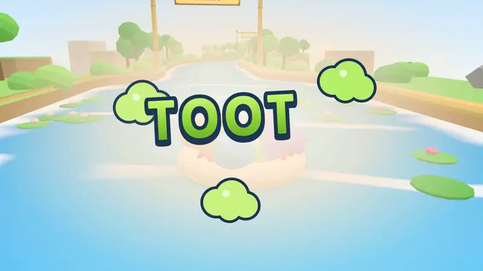

# Toot Together

A co-op physics party game for the browser, inspired by *Fart Together*. Up to four hippos share one inflatable raft, and the only way to move it is to toot. Each hippo waddles around the rim and pushes the raft away from its own butt, so everyone's toots add up into one direction and one bad toot ruins it for everyone.

**Play it at https://toottogether.fun**



## Run it

```bash
pnpm install
pnpm dev            # game on http://localhost:5173, room server on :2567
```

Open the URL, pick a name, and choose a mode:

| Mode | How |
| --- | --- |
| **Play solo** | One hippo, keyboard / gamepad / touch. |
| **Couch party** | Up to 4 hippos on one screen: WASD + Space, Arrows + Enter, and gamepads (press A to join). |
| **Online** | **Create room**, pick a river, then share the 4-letter code or the invite link from the HUD. Friends hit **Join**. |
| **Race** (online) | **Create room**, switch the river picker to **Race** and choose 2–4 rafts. Everyone picks a raft, readies up, and the start gate drops on GO. First raft to the finish wins. |

To play online on your LAN, friends open `http://<your-ip>:5173` (Vite prints it as "Network").

### Production

```bash
pnpm build
pnpm start          # serves the built game + WebSocket rooms on one port ($PORT, default 2567)
```

Any Node host that supports WebSockets will run it (a VPS, Render, Railway, …). It is a single process with no database. Rooms live in memory, so run exactly **one** instance. Behind a reverse proxy, set `TRUST_PROXY_HEADER` to the header that carries the client's IP (say `x-forwarded-for`), or every player counts as the proxy's IP for the rate limits. Set `ROOMS_FILE` (or systemd's `STATE_DIRECTORY`) to keep rooms across a restart.

### Self-hosting

The repo ships everything for a small VM: Caddy in front for HTTPS and the WebSocket proxy, and the Node server running as the `toot-together` systemd service.

1. Point a domain's A record at a fresh Ubuntu 24.04 VM, and open TCP 80 and 443 in your cloud provider's firewall.
2. Copy `deploy/` to the box and run `sudo bash setup-server.sh <domain> [other domains…]` there. It opens 80/443 in the VM firewall and adds swap, then installs Node 24, pnpm and Caddy. Any other domains (say `www.<domain>`, or one the game moved from) permanently redirect to `<domain>`. It is safe to re-run.
3. Copy `.env.example` to `.env.local` and fill in `DEPLOY_HOST` and `DEPLOY_URL`. `VITE_POSTHOG_KEY` is optional: without it, analytics stay off.

```bash
scripts/deploy.sh                                     # builds locally, uploads a release, restarts, checks /health
ssh <deploy host> journalctl -u toot-together -f         # logs
```

Redeploying restarts the server, so **never deploy while anyone is on it**. `/health` shows `rooms` and `sockets`, and `scripts/deploy.sh` refuses to run while any socket is connected. Rooms are parked in `/var/lib/toot-together/rooms.json` on the way down and restored on the way up. That is a safety net for crashes and unplanned restarts, not a reason to deploy over players: they still freeze, and a release that changes the simulation's state drops their rooms. See `AGENTS.md` for the full deploy checklist.

## Controls

| | Keyboard | Gamepad | Touch |
| --- | --- | --- | --- |
| Walk around the rim (hold) | A / D (P2: ← / →) | D-pad left / right | |
| Stand at the front / back | W / S (P2: ↑ / ↓) | D-pad up / down | |
| Stand where you point | | Left stick | Drag on the left half |
| Toot (hold) | Space (P2: Enter or /) | A / RT / LT | TOOT |
| Burst | Left Shift / E (P2: Right Shift or .) | X / RB / B | BURST |
| Respawn | R | Back/Select | Respawn button |
| Menu | Esc / P | Start | Menu button |
| Chat (online) | Hold Q, move the mouse, let go (or tap Q, then 1–8); T to type | | Chat button: tap to type, hold and slide to pick a line |
| Ready / start the race / hop on (race rooms) | Y | Y | The big button |
| Crews: raft count, shuffle, move hippos (race host) | C | | Crews button |

Hold left or right and your hippo keeps walking around the rim; point the stick and it walks to that spot. Its butt faces outward, so a toot pushes the raft the opposite way. To go forward, stand at the back. The arrow on the water shows where your toot will push.

A lone hippo has the whole rim. In a crew of 2–4, each hippo owns an equal slice (shown in its colour on the raft ring) and stops at the edge of it, so nobody can wander into a teammate's spot. Slices are handed out in seat order and start at the back, so two hippos can always share the forward push.

In a race, each raft has a colour and a shape (Red ▲, Yellow ●, Teal ■, Pink ◆) and its own crew of 1–4. Rafts bump off each other, a toot shoves any rival raft behind it, and snacks go to whoever gets there first. Once the first raft finishes, the rest have 30 seconds to cross the line. Opening the link puts you on the raft with the most room, and one tap switches. Arrive mid-race and you watch from the bench until you hop on.

What's in the game and how it's built: [OVERVIEW.md](OVERVIEW.md).

## License

[MIT](LICENSE)
